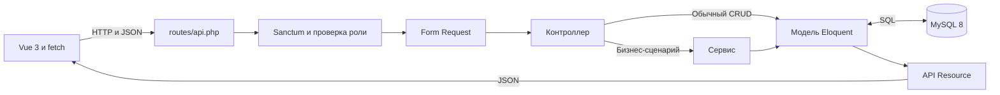
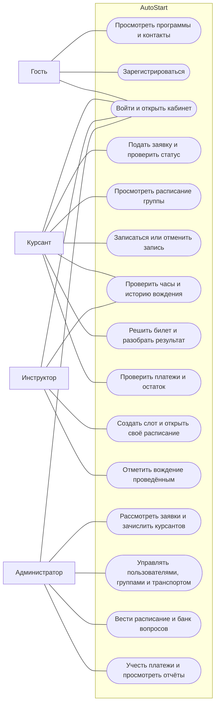

# Архитектура AutoStart

AutoStart обслуживает набор и обучение в автошколе. Курсант подаёт заявку в группу, изучает расписание, выбирает вождение и решает билеты ПДД. Инструктор планирует свободное время и отмечает проведённые занятия. Администратор ведёт набор, справочники, расписание, платежи и отчёты. Гость может прочитать о программах и создать аккаунт курсанта.

## Требования к функциям

1. Система должна позволять гостю просматривать программы и регистрироваться с ролью курсанта.
2. Система должна позволять пользователю войти, изменить имя и телефон и завершить сеанс.
3. Система должна позволять курсанту выбрать категорию и подать заявку в открытую группу.
4. Система должна позволять администратору подтверждать и отклонять заявки с проверкой вместимости.
5. Система должна позволять курсанту видеть расписание групп, в которые он зачислен.
6. Система должна позволять инструктору создавать свободные слоты и проверять своё расписание.
7. Система должна позволять курсанту записаться на доступное вождение и отменить запись до начала.
8. Система должна позволять инструктору завершать проведённые занятия с расчётом часов.
9. Система должна позволять курсанту решать билеты ПДД и разбирать результаты попыток.
10. Система должна позволять администратору вносить платежи и формировать отчёты за период.
11. Система должна позволять курсанту видеть собственные платежи и остаток за обучение.
12. Система должна позволять администратору искать, фильтровать, сортировать, добавлять, редактировать и удалять записи в справочниках.

## Требования к реализации

- PHP 8.3+ и Laravel 13 обслуживают REST API. Клиент Vue 3 работает на отдельном адресе и получает JSON через `fetch`.
- MySQL 8 хранит данные приложения. Eloquent связывает записи через внешние ключи и промежуточную таблицу.
- Sanctum выдаёт временные Bearer-токены. Пароли хешируются стандартным хешером Laravel.
- Middleware ограничивает доступ по ролям. Политики проверяют право на конкретное занятие, попытку экзамена или платёж.
- Form Request проверяет входные данные. Resource определяет, какие поля можно вернуть клиенту.
- Запись на вождение и зачисление используют транзакции и блокировки строк. API описан в документации и коллекции Postman.

Composer управляет зависимостями PHP и автозагрузкой классов. Laravel предоставляет маршрутизацию, валидацию, миграции и обработку ошибок. Eloquent даёт доступ к MySQL через модели и связи. Vue Router переключает страницы, а Bootstrap отвечает за базовые формы, сетку и таблицы. Vite запускает клиент локально и собирает статические файлы.

## Путь запроса

`AuthController` обслуживает регистрацию, вход, выход и профиль. Контроллеры групп, пользователей, транспорта, вопросов и платежей выполняют обычные CRUD-операции. `EnrollmentService` управляет заявками, `LessonService` проверяет расписание и переходы статусов, `ExamService` проверяет билет. Политики вызываются при чтении конкретной записи и при изменении занятия. При ошибке валидации форма получает код 422 и список ошибок по полям.

## Варианты использования

