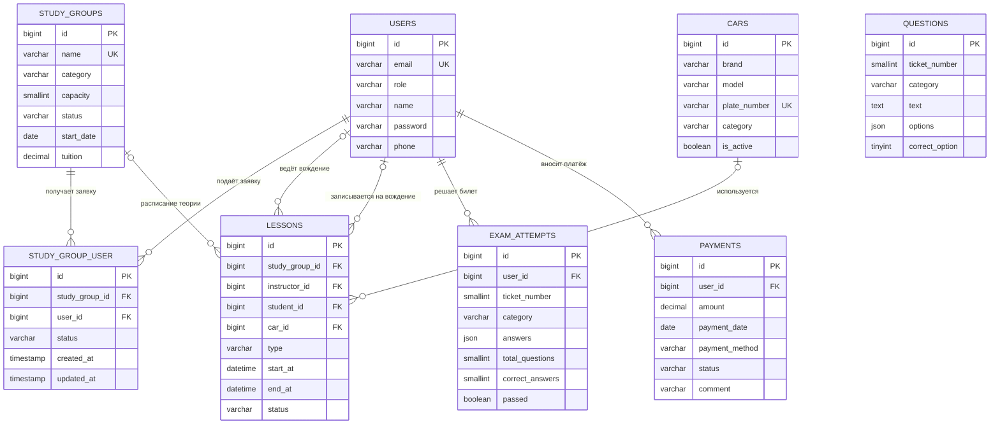

# Сущности и связи

AutoStart использует семь основных моделей Eloquent. Связь между курсантом и группой хранит заявку и итог рассмотрения в `study_group_user`.

| Модель | Таблица | Основные поля | Связи Eloquent |
| --- | --- | --- | --- |
| `User` | `users` | `name`, `email`, `password`, `role`, `phone` | `studyGroups` belongsToMany. `drivingLessons`, `instructedLessons`, `examAttempts`, `payments` hasMany |
| `StudyGroup` | `study_groups` | `name`, `category`, `capacity`, `status`, `start_date`, `tuition` | `students` belongsToMany. `lessons` hasMany |
| `Lesson` | `lessons` | `type`, `study_group_id`, `instructor_id`, `student_id`, `car_id`, `start_at`, `end_at`, `status` | `studyGroup`, `instructor`, `student`, `car` belongsTo |
| `Car` | `cars` | `brand`, `model`, `plate_number`, `category`, `is_active` | `lessons` hasMany |
| `Question` | `questions` | `category`, `ticket_number`, `text`, `options`, `correct_option` | Вопросы одного билета выбираются по паре категория и номер |
| `ExamAttempt` | `exam_attempts` | `user_id`, `category`, `ticket_number`, `answers`, `total_questions`, `correct_answers`, `passed` | `user` belongsTo |
| `Payment` | `payments` | `user_id`, `amount`, `payment_date`, `payment_method`, `status`, `comment` | `user` belongsTo |
| Промежуточная таблица | `study_group_user` | `user_id`, `study_group_id`, `status`, даты | Соединяет `User` и `StudyGroup` |

Каждая основная таблица имеет первичный ключ `id` типа `BIGINT UNSIGNED` и поля времени создания и изменения. Внешние ключи имеют тот же тип. Миграции задают длину строк, значения по умолчанию и точные индексы.

[Физическая схема MySQL](schema.mysql.sql) выгружена из базы, созданной миграциями. SQL-файл рассчитан на отдельную пустую схему. Для обычного запуска приложения используйте миграции Laravel.

## ER-диаграмма



## Ограничения

- У занятия по теории заполнена группа. У практики заполнены инструктор и транспорт. У свободного слота `student_id` равен `NULL`. Сервис устанавливает поля согласно типу занятия и изменяет статус по отдельным действиям.
- Пара `study_group_id` и `user_id` уникальна. Уровень Eloquent дополнительно проверяет активные заявки категории и вместимость при зачислении.
- Email и госномер уникальны. Госномер сохраняется в верхнем регистре без пробелов. Индексы `(category, status, start_date)` у групп и `(type, status, start_at)` у занятий поддерживают фильтры расписания. Поиск пересечений опирается на индексы участника или транспорта и времени.
- Занятия, платежи и попытки защищены внешними ключами с `RESTRICT`. Для промежуточных строк используется `CASCADE`, а API проверяет допустимость удаления родителя. Токены пользователя удаляются при смене роли, пароля или удалении учётной записи.
- Стоимость и сумма платежа хранятся в `DECIMAL(10,2)`. Дата платежа и начало курса имеют тип `DATE`, время занятий имеет тип `DATETIME`. Суммы возвращаются строками с двумя знаками после точки.
- Категория, роль и статус занятия хранятся строками. В коде их значения задают PHP Enum. Варианты вопроса и ответы попытки хранятся в JSON.
- Расписание, группа, транспорт и участники хранятся в отдельных таблицах. Часы рассчитываются из завершённых занятий. Снимок вариантов в попытке фиксирует содержание пройденного билета для разбора после изменения вопроса.

## Примеры запросов для проверки связей

```sql
SELECT u.name AS student, g.name AS study_group, gu.status
FROM study_group_user AS gu
JOIN users AS u ON u.id = gu.user_id
JOIN study_groups AS g ON g.id = gu.study_group_id
ORDER BY gu.id;

SELECT l.start_at, i.name AS instructor, c.plate_number, s.name AS student
FROM lessons AS l
JOIN users AS i ON i.id = l.instructor_id
JOIN cars AS c ON c.id = l.car_id
LEFT JOIN users AS s ON s.id = l.student_id
WHERE l.type = 'driving' ORDER BY l.start_at;

SELECT u.name, SUM(p.amount) AS paid
FROM payments AS p
JOIN users AS u ON u.id = p.user_id
WHERE p.status = 'received'
GROUP BY u.id, u.name ORDER BY u.name;
```
