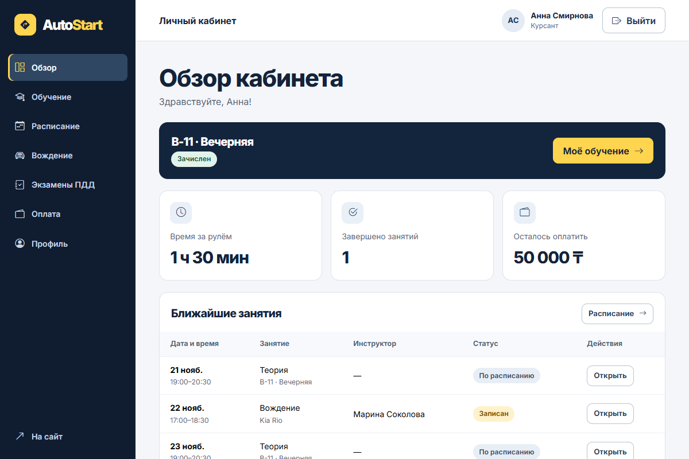
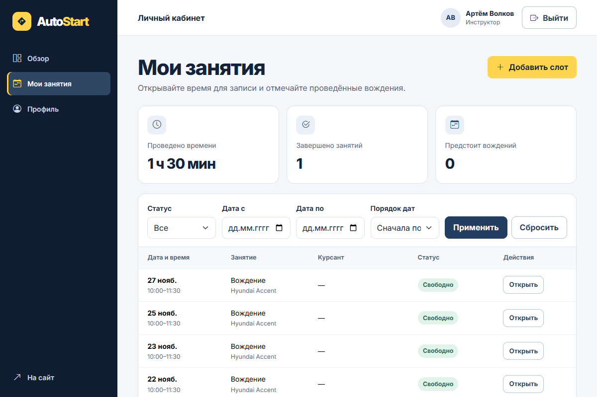
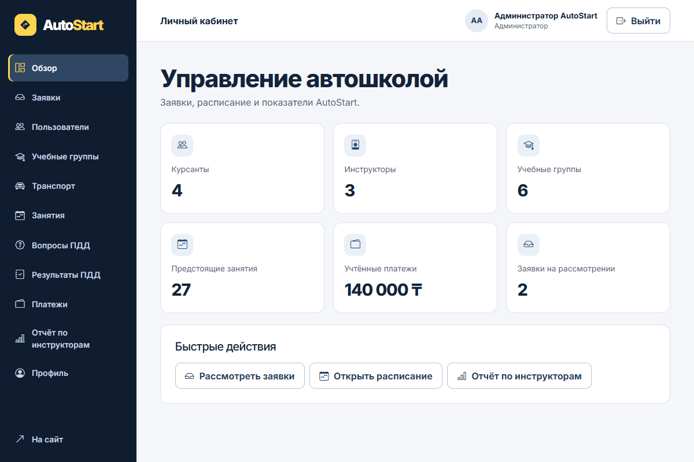

# Руководство пользователя AutoStart

Инструкции по установке и локальные аккаунты находятся в [README](../README.md). Это руководство описывает действия на уже запущенном сайте.

## Вход и регистрация

1. Откройте главную страницу AutoStart и перейдите к регистрации.
2. Укажите имя, электронную почту, телефон и пароль с подтверждением.
3. После регистрации откроется кабинет курсанта. Для последующих входов используйте почту и пароль.
4. В разделе «Профиль» можно изменить имя и телефон.
5. Кнопка «Выйти» завершает текущий сеанс.

Регистрация создаёт курсанта. Инструкторов и администраторов назначает администратор школы.

Для одновременного показа разных ролей используйте отдельные профили браузера. В обычных вкладках одного профиля данные входа общие.

## Кабинет курсанта

На странице «Обзор» находятся группа, состояние зачисления, ближайшие занятия, время за рулём и остаток оплаты.

### Заявка на обучение

1. Откройте «Обучение» и вкладку «Открытые группы».
2. Выберите категорию прав и подходящую дату начала. При необходимости найдите группу по названию.
3. Нажмите «Подать заявку», затем «Отправить» в окне подтверждения.
4. Откройте вкладку «Мои заявки», чтобы увидеть решение школы.

| Статус | Что означает |
| --- | --- |
| На рассмотрении | Заявка отправлена; администрация ещё не приняла решение |
| Зачислен | Участие подтверждено, доступно расписание группы и вождение нужной категории |
| Отклонена | Заявка отклонена; можно подать новую допустимую заявку |

Подать повторную активную заявку той же категории нельзя. В закрытую или заполненную группу записаться нельзя. Отправленная заявка сама по себе ещё не занимает место: зачисление подтверждает администратор.

### Теоретические занятия

В разделе «Расписание» показаны занятия подтверждённых групп. Укажите группу и диапазон дат, затем нажмите «Применить». Кнопка «Сбросить» очищает фильтры. Кнопка «Открыть» в строке показывает сведения о занятии.

Если после подачи заявки расписание пустое, сначала проверьте статус зачисления. Если участие подтверждено, уточните у администратора, добавлены ли занятия группы.

### Запись на вождение

1. Откройте «Вождение» и вкладку «Свободные занятия».
2. Выберите инструктора и нужный период.
3. В карточке проверьте дату, время, длительность и автомобиль.
4. Нажмите «Выбрать время», затем «Записаться» на странице занятия и подтвердите действие.
5. Вернитесь во «Вождение» и откройте «Мои занятия».

Доступны будущие занятия категории подтверждённой группы. При пересечении с уже назначенной практикой или теорией запись отклоняется. Если выбранное время успел занять другой курсант, выберите другой свободный вариант.

До начала забронированного занятия можно открыть его и нажать «Отменить запись». После подтверждения время снова станет свободным. Отмена самим курсантом снимает его текущую бронь со слота.

Часы практики увеличиваются после того, как инструктор отметит занятие проведённым. Например, завершённое вождение длительностью 90 минут добавляет 1 час 30 минут. Предстоящие и отменённые занятия в пройденные часы не входят.

### Билеты ПДД

1. Откройте «Экзамены ПДД».
2. Выберите категорию и билет, нажмите «Начать билет».
3. Отметьте один ответ на каждый вопрос.
4. Нажмите «Проверить ответы» и просмотрите результат с разбором.
5. Для повторного просмотра откройте вкладку «История попыток».

Порог зачёта указан в разделе экзаменов; исходная настройка составляет 80%. Проходить билеты можно повторно. История сохраняет содержание пройденного билета и выбранные ответы, поэтому разбор остаётся доступен после изменения вопросов администрацией.

Если содержание билета изменилось во время прохождения, появится сообщение с предложением загрузить его заново. Начальный набор содержит собственные тренировочные вопросы проекта.

### Оплата

В разделе «Оплата» показаны стоимость обучения, учтённые взносы и остаток. Ниже находится история с фильтрами по датам и статусу. Стоимость доступна, когда она указана у подтверждённых учебных групп.

| Статус платежа | Значение |
| --- | --- |
| Ожидает подтверждения | Заявка на наличный взнос отправлена; сумма ещё не включена в оплаченное |
| Учтён | Платёж включён в оплаченную сумму |
| Аннулирован | Запись отменена |

Локальная форма «Демо-оплата» моделирует учёт взноса. Операция картой сразу создаёт учтённую запись, наличные ожидают подтверждения администратора. Настоящее списание с банковской карты не выполняется. Ожидающую наличную заявку можно отменить из истории; её сумма снова станет доступна для внесения.

## Кабинет инструктора

### Создание свободного времени

1. Откройте «Мои занятия» и нажмите «Добавить слот».
2. Выберите транспорт, дату и время начала и окончания.
3. Нажмите «Сохранить слот».

Окончание должно быть позже начала, занятие должно находиться в будущем. Автомобиль должен быть активен. При пересечении с другим занятием инструктора или автомобиля сохранение отклоняется с объяснением причины.

После сохранения слот доступен зачисленным курсантам подходящей категории. В расписании можно выбирать статус, период и порядок дат.

### Завершение занятия

1. Найдите забронированное занятие в своём расписании и нажмите «Открыть».
2. После времени окончания нажмите «Отметить проведённым».
3. Подтвердите действие. Статус изменится на «Проведено», часы отразятся в статистике инструктора и курсанта.

Завершить свободный слот или будущее занятие нельзя. Инструктор работает только со своими занятиями. Для отмены своей предстоящей практики используйте «Отменить занятие» на странице записи.

## Кабинет администратора

Главная страница показывает число курсантов, инструкторов и групп, предстоящие занятия, учтённые платежи и ожидающие заявки.

### Рассмотрение заявок

1. Откройте «Заявки» и выберите статус «На рассмотрении».
2. Найдите курсанта по имени или группе; при необходимости уточните категорию.
3. Нажмите «Зачислить» либо «Отклонить» и подтвердите решение.

При зачислении проверяются свободные места и совместимость расписания. Сообщение о конфликте означает, что нужно изменить исходные условия, например выбрать другую группу или время занятий.

Администратор также может нажать «Добавить заявку» и выбрать курсанта и открытую группу. После создания такой заявки отдельно принимается решение о зачислении.

### Справочники и занятия

| Раздел | Назначение |
| --- | --- |
| Пользователи | Аккаунты, данные профиля и роли |
| Учебные группы | Категория, набор, вместимость, дата начала и стоимость |
| Транспорт | Автомобили, государственные номера, категории и активность |
| Занятия | Теория учебных групп и практика с инструктором и автомобилем |
| Вопросы ПДД | Тексты вопросов, варианты и правильный ответ |
| Результаты ПДД | Сохранённые попытки курсантов и разбор ответов |

В таблицах используйте поиск, фильтры, сортировку и переход по страницам. При создании или редактировании заполните поля формы и сохраните запись. Ошибки значений появляются рядом с полями. Удаление требует подтверждения.

Связанные записи защищены от удаления. Например, автомобиль с учебной историей и пользователь с платежами не удаляются как обычная пустая запись. При отказе прочитайте сообщение и проверьте связанные занятия или данные.

### Платежи и отчёты

В разделе «Платежи» администратор вносит сумму, дату, способ, статус и комментарий. Ручную ошибочную запись можно отредактировать или удалить, если действие разрешено для этой записи. Ожидающую наличную заявку подтверждают после получения взноса; только после подтверждения сумма считается оплаченной.

Для отчёта откройте «Отчёт по инструкторам», укажите период и примените фильтр. В отчёте видны завершённые занятия и проведённые часы. Период определяется датой окончания занятия.

## Частые ситуации

| Ситуация | Действие |
| --- | --- |
| Сеанс истёк | Войдите в кабинет повторно |
| Свободное вождение не отображается | Проверьте зачисление, категорию и фильтры; уточните, созданы ли будущие слоты |
| Время уже недоступно для записи | Обновите список и выберите другой свободный слот |
| Занятие нельзя завершить | Проверьте время окончания, наличие курсанта и принадлежность занятия инструктору |
| Сумма наличного взноса ещё не уменьшила остаток | Дождитесь подтверждения администратором |
| После перезагрузки страницы нет новых данных | Проверьте подключение к приложению и сообщение об ошибке; инструкции диагностики есть в README |

Снимки интерфейса получены в отдельном локальном экземпляре с начальным наполнением. Даты, имена, группы и суммы на снимках иллюстрируют работу кабинетов; в установленном приложении отображаются записи его собственной базы.
